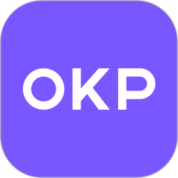

  

# OKP 扫地机器人（OKP Cloud）

通过 **OKP 云账号（用户名 + 密码）** 把 OKP / 乐帆（Lefant）扫地机器人（如 **OKP K5 Ultra**）接入 Home Assistant，无需本地密钥、无需第三方中转。

## ✨ 功能

- 🔐 **用户名 + 密码登录** OKP 云（`api-cn.okplife.com`），自动完成请求签名与令牌管理
- 🏠 自动发现账号下的家庭与扫地机器人设备
- ⚡ **实时推送**：像 App 一样保持一条 CoolKit WebSocket 长连接，机器上报的状态 1 秒内进 HA（清扫中尤其明显）；断线自动重连，连不上就退回轮询，功能不受影响
- 📡 3 分钟状态轮询兜底：电量、清扫状态、工作状态、故障码、信号强度、固件版本、清扫面积/次数、定时任务摘要、最近清扫时间、固件更新检查等
- 🎮 完整控制：开始清扫 / 暂停 / 停止 / 回充 / 三档吸力（安静 · 标准 · 强力）/ 清扫模式（智能 · 随机 · 沿墙 · 螺旋）/ 地毯增压开关
- 🗺️ 清扫地图（camera 实体，PNG 渲染，5 分钟探测 / 30 分钟自动刷新）
- 🔄 CoolKit 令牌过期自动静默刷新；**不自动密码重登**（OKP 云单会话，重登会顶掉手机 App）——令牌彻底失效时自动弹窗重新认证
- 💾 云端离线时保留最后已知状态（实体永不 `unavailable`）

## 📦 安装

### 方式一：HACS（推荐）

1. HACS → 「自定义仓库」→ 添加 `https://github.com/RockJesus/ha-okp`（类别：**集成**）
2. 搜索并安装 **OKP Cloud 扫地机器人**
3. 重启 Home Assistant

### 方式二：手动安装

1. 下载最新 [Release](https://github.com/RockJesus/ha-okp/releases/latest) 源码包
2. 解压出 `custom_components/okp_cloud` 目录，放入 `config/custom_components/`
3. 重启 Home Assistant

## ⚙️ 配置

「设置 → 设备与服务 → 添加集成」→ 搜索 **OKP 扫地机器人**，输入 OKP App 的**账号（手机号）**与**密码**，提交即自动完成登录、家庭与设备发现。

后续若令牌失效可在集成上点「重新认证」，或「重新配置」更换账号。

## 🧹 实体（设备：OKP K5 Ultra）

| 实体 | 类型 | 说明 |
| --- | --- | --- |
| `vacuum.okp_cloud_*` | 扫地机 | 清扫状态 / 电量 / 吸力档位 / 控制 |
| `select.okp_cloud_*_mode` | 选择器 | 清扫模式（智能/随机/沿墙/螺旋，可控制） |
| `switch.okp_cloud_*_carpet_booster` | 开关 | 地毯增压（可控制） |
| `sensor.okp_cloud_*_work_state` | 传感器 | 工作状态（清扫/回充/暂停/待机） |
| `sensor.okp_cloud_*_clean_mode` | 传感器 | 清扫模式（smart/random/wall_follow/spiral） |
| `sensor.okp_cloud_*_rssi` | 传感器 | 信号强度（dBm，诊断） |
| `sensor.okp_cloud_*_fault_code` | 传感器 | 故障码（诊断） |
| `sensor.okp_cloud_*_firmware_version` | 传感器 | 固件版本（诊断） |
| `sensor.okp_cloud_*_cleaning_area` | 传感器 | 清扫面积 |
| `sensor.okp_cloud_*_cleaning_times` | 传感器 | 清扫次数 |
| `sensor.okp_cloud_*_battery` | 传感器 | 电量（%） |
| `sensor.okp_cloud_*_dp31` | 传感器 | 数据点 dp31（诊断） |
| `sensor.okp_cloud_*_last_clean_start` | 传感器 | 上次清扫开始（诊断） |
| `sensor.okp_cloud_*_last_clean_end` | 传感器 | 上次清扫结束（诊断） |
| `sensor.okp_cloud_*_ui_active` | 传感器 | 界面活跃值（诊断） |
| `sensor.okp_cloud_*_call` | 传感器 | 呼叫计数（诊断） |
| `sensor.okp_cloud_*_timers` | 传感器 | 定时任务摘要（诊断） |
| `sensor.okp_cloud_*_online` | 传感器 | 在线状态（诊断） |
| `camera.okp_cloud_*_cleaning_map` | 摄像头 | 清扫地图（PNG 渲染） |
| `sensor.okp_cloud_*_firmware_update` | 传感器 | 固件更新检查（OTA，有新版时显示目标版本，否则「已是最新」） |
| `sensor.okp_cloud_*_realtime` | 传感器 | 实时推送通道状态（诊断，见下） |

> 扫地机实体还附带扩展属性：`work_state`、`clean_mode`、`fault_code`、`rssi`、`firmware_version`、`cleaning_area`、`cleaning_times`、`carpet_booster`、`online`、`last_error`。

## ⚡ 实时推送

集成会像 App 一样，向云端的区域节点开一条 WebSocket 长连接（`dispatch/app` → `wss://…/api/ws` → `userOnline`），
设备每次上报的 dp 变化立刻合并进实体状态，**不再等 3 分钟轮询**。这条通道是只读的——所有控制仍然走
HTTP 接口，所以它不可能把机器人置成 App 里做不出来的状态。

3 分钟轮询并未取消，仍然是兜底：连接断了、被路由器掐了、账号会话异常，都只是"慢回 3 分钟"，实体照常工作。
连续推送时也至少每 15 分钟强制做一次 HTTP 读取，保证令牌续期、地图刷新、OTA 检查不会饿死。

`sensor.okp_cloud_*_realtime` 会显示当前通道状态：`connected` 已连接 / `connecting` 连接中 /
`disconnected` 断线重连中 / `error` 连接失败（仍在轮询） / `disabled` 未启用。属性里有
`host`（当前节点）、`device_pushes`（收到的设备推送条数）、`last_push_at`、`last_poll_at`、`last_error`。

如果测试发现这条连接和手机 App 抢会话（打开 App 后推送变 `error` 或反复重连），在
**「设置 → 设备与服务 → OKP 扫地机器人 → 配置」** 里关掉「启用实时推送」即可，其他功能完全不变。

## 🎛️ 支持设备

- **OKP K5 Ultra**（实测，CoolKit / ThingClips 云）
- 其他 OKP / 乐帆云账号下的扫地机理论上兼容（协议相同）

## 🔧 技术说明（协议逆向摘要）

点击展开

- 登录：`POST /v5/client/login-with-password`（`password` + `account`）
- 签名：`MD5(client-id=...&timestamp=<ms>&key=...)`——自 APK `TokenInterceptor` 指令级逆向，43/43 个抓包请求复算命中
- 设备：`/v2/home/list` → `/v9/home/device-list` → `/v5/home/device-detail-info`
- 令牌：`GET /v1/coolkit/get-user-info`（okplife，带签名头）换取 CoolKit `at`/`rt`/`apikey`；
  续期走 `POST cn-apia.coolkit.cn/v2/user/refresh`（body `{"rt":…}`，且**必须**带 `Authorization: Bearer <hex>`）
- 状态：`POST cn-apia.coolkit.cn/v2/device/thing`（body `{"thingList":[…]}`）
- 控制：`POST cn-apia.coolkit.cn/v2/device/thing/status`（body `{"type":1,"id":…,"params":{…}}`）
- 实时：`GET cn-dispa.coolkit.cn/dispatch/app` 取节点 → `wss://<domain>:443/api/ws` →
  发 `{"action":"userOnline","apikey","appid","at","version":8}` → 回 `{"error":0,"config":{"hbInterval":145}}` →
  约每 72 秒发文本 `ping` 收 `pong`；设备上报为 `{"action":"update","userAgent":"device","params":{…}}`

## ⚠️ 已知限制

- **回充 = 停止清扫**（CoolKit 无独立回充 dp）；若你的机型不回充，请抓包一次「回充」动作反馈后补充
- **暂停 = 停止清扫**（`sweep=0`），与 App 行为一致
- 密码保存在 HA 配置存储（`.storage/`）中，仅用于首次配置/重新认证时登录；运行中不使用密码

## 📝 更新日志

- v1.3.3（2026-11-01）：**接入和 App 一样的 WebSocket 实时推送**。此前所有实体都靠 180 秒轮询，清扫过程中状态最多晚 3 分钟才反映到 HA；现在按抓包还原的协议（`dispatch/app` 取节点 → `wss://<domain>/api/ws` → `userOnline` 握手 → 每 72 秒 `ping`/`pong` → 设备 `update` 帧）开一条长连接，设备已上报的 dp 变化秒级合并进实体。设计上只读、只做加速：控制仍走 HTTP，轮询保留做兜底与令牌/地图/OTA 维护，连续推送时也至少每 15 分钟强读一次；握手失败按 0/5/15/30/60/120/300 秒退避重连，失败只在日志里说一次。新增诊断传感器 `sensor.okp_cloud_*_realtime`（状态 + `host`/`device_pushes`/`last_push_at`/`last_poll_at`/`last_error`），以及「配置」里的**启用实时推送**开关（万一与手机 App 抢会话可一键退回纯轮询，无需删除集成）。`refresh_session` 服务响应新增 `realtime` 字段，令牌续期后会主动重连以换用新令牌。顺带修正 README 技术说明里过时的控制端点（`thing/update` → `thing/status`）与令牌获取路径（`refresh-access-token` → `get-user-info` → `user/refresh`）
- v1.3.2（2026-11-01）：修掉「控制完要等 3 分钟界面才变」的体验问题。各实体读的都是轮询缓存，而云端回显设备状态有几秒延迟，写完立刻读只会读到旧值，于是 `vacuum.set_fan_speed`／`switch` 之类操作后界面长时间不动（`vacuum` 平台此前压根没有触发刷新，只能等下一轮 180 秒轮询）。现在所有控制动作统一走 `coordinator.async_schedule_refresh()`：写完安排两次延迟回读（约 4 秒、12 秒），既不会读太早，也不用等整轮轮询。实测：写 `quiet` 后约 15 秒 `fan_speed` 已变为 `quiet`，地毯增压同样能即时回读
- v1.3.1（2026-11-01）：给地图相机关联诊断属性 `map_id` / `map_updated_at` / `last_error`。地图出问题时相机只会默默继续给旧图，界面上看不出这张图是哪一次清扫的、是不是已经过期，现在能直接确认（`map_id` 是实际命中的上传 id，`last_error` 会写出 `405 NoSuchKey` 这类原因）。同时修正 v1.3.0 日志里两处过度表述：地图 id 与历史 `from` 单位这两条，实测原本也能正常工作，改动属于「与 App 行为完全对齐 + 提高地图新鲜度」，不是修复既有故障
- v1.3.0（2026-11-01）：按抓到的 App 全功能 HAR（Reqable，v3.4.0）逐条比对后补强。**修复**：① `vacuum.stop` 不再写 `switch: 0` —— App 全程把 `switch` 保持为 1，它是整机电源态，写 0 有把机器人关机、之后云控彻底失联的风险，现在与 App 一致只发 `sweep: 0`；② 地图取图改为**上传 id 优先**（`startUpload`/`endUpload`，如 `015c`），`cleaningId`（如 `0125`）兜底 —— App 只按上传 id 取图，而上传 id 是按次生成的，最近一次常常还没传完就返回 `405 NoSuchKey`。现在按「新→旧」依次尝试、自动跳过没准备好的那次（实测本账号两种 id 都能出图，属于对齐 App + 提高新鲜度，不是原有故障）；③ 历史接口的 `from` 改为**微秒**，与 App 的 16 位时间戳一致（两种单位服务端都接受，改后与 App 行为完全相同）。**新增**：④ 开关「地毯检测」（`dp31`）—— 厂商设备详情里的功能名就是 `carpet_detection_switch`，之前只做成诊断传感器，App 里它是个正常开关；⑤ 按钮「查找机器人」（写 `call: 1`，机器响铃）；⑥ 服务 `okp_cloud.set_timer`（按 `mId` 启停一条定时任务，先重读整组再改单条并回读校验，不会覆盖 App 里新增/删除的任务）；⑦ 定时任务传感器的 `timers` 属性列出每条任务的 `mId`／周期／模式／吸力，供上面的服务直接引用（已验证：`wind` 枚举 0/1/2、`mode` 枚举 `smart/random/wall_follow/spiral` 与集成原有映射一致）
- v1.2.12（2026-11-01）：把「过期时间是推断还是云端给的」这个事实持久化到配置条目。此前重启后 `at_expire_inferred` 会回到默认的 `false`，于是 v1.2.11 推断出来的 25 天会被传感器显示成 `token_expiry_source: cloud`，排查时容易误判成「云端说还剩 25 天」。现在同时持久化 `coolkit_at_expire_inferred` 和学到的 `coolkit_at_lifetime`，重启后诊断信息保持准确；`refresh_session` 服务的响应也补上 `at_lifetime_hours`
- v1.2.11（2026-11-01）：把「续期响应不含过期时间」时的推断值从 1 小时改为 **25 天**。CoolKit/eWeLink 官方文档明确写 *Access Token expires in 30 days, you can use Refresh Token to refresh instead of logging in again*，本账号首次认证实测也正好是 30 天 —— 说明那把 `at` 的真实寿命就是 30 天，1 小时的推断纯属过度保守，副作用是把 HA 的**停机容错窗口压到了 1 小时**：只要停机超过 1 小时，存下来的令牌就已过期，恢复后只能人工重新认证。改成 25 天（留 5 天余量）后，**停机 25 天以内恢复都能自愈，完全不需要人工**。同时新增真实寿命学习：只要云端某次真的返回了过期时间，就按那个跨度更新 `at_lifetime`，后续推断自动跟随；会话传感器新增 `at_lifetime_hours`（当前采用的寿命假设，等于容忍的停机时长）
- v1.2.10（2026-11-01）：修正续期成功后的过期时间推断。实测发现 `POST /v2/user/refresh` 成功时只返回 `at` / `rt`，**不返回过期时间**；旧代码这时会沿用上一次的过期时间（本次是 11-30），于是新令牌明明只有很短的有效期，轮询却认为「还早得很」，等到真正去续期时新令牌早就死了 —— 又变成需要重新认证。现在续期响应里没有可解析的过期时间时，一律按 1 小时推断（`rt` 续期很便宜），宁可多刷一次，也不在令牌死后才发现。同时会话传感器新增 `token_expiry_source`（`cloud` = 云端给的，`inferred` = 本地推断）和 `last_refresh_fields`（上次续期响应实际返回的字段名，用于排查网关改字段），`refresh_session` 服务的响应也一并返回这些信息，并额外给出 `token_expires_in_seconds`
- v1.2.9（2026-11-01）：新增服务 `okp_cloud.refresh_session`（手动续期云会话）。访问令牌的有效期长达数周，`rt` 续期路径要等令牌快过期才会自然触发，既没法立刻确认它真的可用，也没法在掉线时手动救一次。该服务直接调用轮询里同一套续期代码，立即用 `rt` 换新令牌、写回配置条目，并把 `refreshed_by` / `session_state` / `token_expires_at` / `error` 作为响应返回，在「开发者工具 → 操作」里就能看到结果。实测：手机 App 已登录的情况下，集成侧调用该服务仍能成功换出新的访问令牌，随后轮询、控制、回读全部正常，证明两者已互不干扰
- v1.2.8（2026-11-01）：修正访问令牌过期时间的解析与续期时机——`get-user-info` 返回的过期时间字段名不固定（`at_expire_at` / `atExpiredTime` / `expireAt`，部分为毫秒），旧代码只认一个名字，取不到时过期时间恒为 0，于是退化成「每 12 小时才刷新一次」。而续期接口要求 `Authorization` 里的访问令牌**服务端仍然认识**，刷新太晚就会在令牌已死之后才去续期，直接退化成重新认证。现在兼容多种字段名并把无过期时间时的兜底间隔改为 1 小时，确保始终在令牌还有效时完成续期
- v1.2.7（2026-11-01）：云会话传感器新增 `stale`（需要重新认证一次）状态。实测确认 `POST /v2/user/refresh` 的 `Authorization` 只接受服务端认识的访问令牌，用刷新令牌本身去带这个头会返回 `401 cannot found access token info`；因此当访问令牌已被旧版本清空或已被拒绝时，`rt` 无法自行换出新令牌，必须先重新认证一次 —— 之后 `rt` 才能接管续期。传感器之前在这种情况下仍显示 `rt`，属于误报，现已修正
- v1.2.6（2026-11-01）：**rt 续期其实一次都没成功过** —— 找到并修掉了根因。`POST /v2/user/refresh` 要求 `Authorization: Bearer <hex>` 头，缺少时服务端返回 `400 "authorization" is required`；旧代码不带这个头，且把错误只记在 debug 级别，所以每次续期都静默失败、再回退到 okplife 登录令牌（于是 App 一登录就掉线）。现在：
  ① 续期请求带上 `Authorization` 头，先试 `Bearer <访问令牌>`，再试 `Bearer <刷新令牌>` —— 即使访问令牌已过期也能续期；
  ② **不再丢弃访问令牌**：之前 401/402/403 都会把 `coolkit_at` 置空，而它正是续期请求的认证头来源，清掉就等于永久放弃自续期。现在只标记「已被拒绝」（`at_rejected`），值保留，下次轮询用 rt 换新令牌；
  ③ 仅当服务端明确拒绝刷新令牌（402/403）才丢弃 rt；400/401 属于请求格式或认证头问题，保留并继续尝试
- v1.2.5（2026-11-01）：解决「手机 App 一登录、集成就掉线」的可观测性与自愈问题——
  ① **新增诊断传感器 `sensor.*_session`（云会话）**：取值 `rt`（已存刷新令牌，自行续期，不受 App 登录影响）、`okplife`（只有访问令牌，续期必须走 OKP 登录令牌，而 App 登录会把它顶掉）、`expired`（无令牌）。属性给出令牌过期时间、最近一次续期失败原因、连续认证失败次数 —— 掉线原因一眼可见，不用再猜；
  ② **修复 `rt` 被覆盖**：`get-user-info` 若不返回 `rt`，旧代码会把已经保存的 `rt` 覆盖成 `None`，导致会话退回「依赖登录令牌」并永久失去自续期能力；现在只有拿到新值才覆盖；
  ③ **不再轻易丢弃 `rt`**：旧代码把所有 4xx 都当作「rt 被拒」并清空，连 `403 api not found`（路由/参数问题）也清，而清掉之后只能人工重新认证。现在仅 401/402（或 403 且错误信息明确指向 rt）才清空；
  ④ **日志降噪**：本地续期节流（`throttled`）不再计为认证失败，也不再输出 warning —— 之前会看到 `auth failed (5/3)` 与 `(6/3)` 交替刷屏；失败计数封顶在 3，同一错误只记一条；
  ⑤ **重新认证提示明确说明单会话限制**：提交表单会注销手机 App，反之 App 登录会顶掉集成，这是云端策略
- v1.2.4（2026-11-01）：修掉 1.2.3 的副作用——重新认证提示被冷却期拖到半小时后才出现。令牌续期失败后的冷却由 900s 降到 300s（续期请求本身已有 120s 节流），冷却期内等待的每个轮询周期也计入认证失败计数，因此连续 3 次（约 9 分钟）就会给出提示；续期一旦成功则立即清零并回到正常轮询
- v1.2.3（2026-11-01）：首次刷新失败不再让条目卡进 HA 的「重试设置」循环——令牌失效时应该弹一次重新认证，而不是持续重试把实体全部藏起来。现在首次取数失败只记一条 warning，平台照常加载，轮询继续尝试，连续 3 次认证失败后给出重新认证提示
- v1.2.2（2026-11-01）：修复「集成每几小时就掉线并要求重新认证」——
  ① **只存了 `coolkit_at` 没存 `coolkit_rt`**：CoolKit 令牌过期后唯一的续期途径是 okplife 的 `/v1/coolkit/get-user-info`，而它依赖 OKP 登录令牌，该令牌几小时就过期且 okplife 没有 refresh 接口 → 整条链路死锁，只能人工重输密码。现在改走 CoolKit 自己的 `POST /v2/user/refresh`（body `{"rt":…}`），它与 OKP 登录令牌无关，会话可无限续期；okplife 仅作兜底。同时把 `at/rt/apikey/region` 全部持久化到配置条目，HA 重启不再丢会话（升级后首次启动会自动补抓一次 `rt`）；
  ② **重启时不再因缺少 `rt` 而反复失败**：`ensure_coolkit_token()` 先试 refresh token，失败才回退 okplife；刷新节流从 300s 降到 120s，且节流不再计入认证失败；
  ③ **不再为一次抖动弹「需要重新认证」**：连续 3 个轮询周期（约 9 分钟）认证失败才会弹窗，成功一次即清零——之前 4001 出现一次就立刻建修复项，看起来像随机报错；
  ④ 轮询彻底失败时抛 `UpdateFailed`，日志里给出 `OKP auth failed (n/3)` 便于判断进展
- v1.2.1（2026-11-01）：修复 1.2.0 实测暴露的三个缺陷——① **控制全部失效**：CoolKit 写状态接口路径写错（`/v2/device/thing/update` 在网关不存在，恒返回 `403 api not found`），改为 `/v2/device/thing/status`，请求体同步改为 `{"type":1,"id":…,"params":…}`；② **重新认证流程崩溃**：`async_step_reauth` 把 HA 传入的配置条目数据当成表单输入，索引已不再保存的 `password` 抛 `KeyError`（日志表现为 `Task exception was never retrieved`），改为标准的 `reauth` + `reauth_confirm` 两步流程；③ 控制失败不再清空 CoolKit 令牌（403 属请求/权限问题，非认证问题），并向界面抛 `HomeAssistantError` 而非原始异常堆栈；重新认证改为回写完整设备列表，多设备场景不会丢设备
- v1.2.0（2026-11-01）：对照 v3.4.0 App 全量操作抓包补齐/修复——① CoolKit 令牌获取改用 App 实测的 `GET /v1/coolkit/get-user-info`（旧 `refresh-access-token` 端点 App 已不再调用，服务端可能已下线）；② 修复清扫记录接口时间戳（改为 13 位毫秒、与 App 完全一致，旧版传微秒导致地图/记录取数异常）；③ 支持账号下的多个家庭（App 可建多家庭，设备可能在任一家庭，配置时全部扫描并去重）；④ 新增 4 个传感器：移动状态（move）、版本（version）、最近清扫时间（取自清扫记录接口）、固件更新（OTA 查询，每小时探测，有新版时显示版本号）；⑤ 工作状态映射按抓包实测校准（清扫中=4）；⑥ 清扫记录开始/结束传感器改显示清扫记录编号（该字段实际是记录 ID 而非时间）；⑦ 无清扫记录时地图状态显示「暂无清扫记录」

展开

- v1.1.9（2026-10-30）：多设备与按型号能力支持——① 一个账号下的多台 OKP/乐帆扫地机全部接入（旧配置自动迁移，单设备升级即生效）；② 每台设备独立轮询与实体（电量/状态/模式/地图各一套）；③ 实体按设备实际能力创建：设备上报里没有的 dp（如地毯增压、定时任务）不再生成对应实体，避免无用/空值实体；④ 枚举语义映射表保留扩展点（当前按 K5 Ultra 校准，其他型号实测后可补充）
- v1.1.8（2026-10-30）：安全与健壮性修复——① 账号密码不再明文写入配置存储（.storage），旧条目升级后自动清理已存密码，重启/重新认证不再依赖本地密码；② 清扫地图 camera 移除无效的开/关按钮（此前 UI 会显示无法使用的开关）；③ CoolKit 令牌失效后对 OKP 云的刷新请求增加 5 分钟冷却，网络异常时不会每 3 分钟重复刷新（防风控）；④ 重新认证/重新配置表单自动预填账号
- v1.1.7（2026-10-29）：实体值全部人类可读化并支持中英双语（默认中文）——工作状态（空闲/清扫中/已暂停/回充中）、清扫模式（智能/随机/沿墙/螺旋）、地毯增压与 dp31（开启/关闭）、在线状态（在线/离线）均按 HA 官方 state 翻译机制本地化；定时任务拆为「启用的定时任务」与「定时任务总数」两个数值传感器；上次清扫开始/结束无记录时显示 —
- v1.1.6（2026-10-29）：补齐未接入的实体与功能——新增清扫模式选择器（select，智能/随机/沿墙/螺旋）、地毯增压开关（switch）、6 个诊断传感器（数据点 dp31、上次清扫开始/结束、界面活跃值、呼叫计数、定时任务摘要）
- v1.1.5（2026-10-29）：配置/重新认证时立即获取并保存长有效期 CoolKit 令牌（与手机 App 多端共存、不互顶），重启不再依赖 OKP 会话；修复自动重新认证流程在部分 HA 版本的兼容性
- v1.1.4（2026-10-29）：令牌彻底失效时自动触发 HA 重新认证流程——HA 弹出重新认证窗口，输入账号密码即可恢复（仍不会自动用密码登录，不影响手机 App）
- v1.1.3（2026-10-29）：设备状态轮询从 30 秒降为 3 分钟——OKP 云把同账号客户端视为唯一在线会话，进一步降低集成对云会话的占用，避免干扰手机 App
- v1.1.2（2026-10-29）：修复手机 App 被顶下线——OKP 云同一账号仅允许一个在线会话，集成此前 token 失效后会自动用密码重登（会把 App 会话挤掉）；现改为令牌自愈模式：全程不再调用密码登录，CoolKit 令牌过期时仅用已有 access token 静默刷新，彻底失效才提示手动重新认证（15 分钟退避）；登录只发生在首次配置/手动重新认证时
- v1.1.1（2026-10-29）：降低对 OKP 云账号的干扰，避免影响手机 App——清扫记录接口探测频率从每次轮询改为 5 分钟一次；登录失败增加 15 分钟退避（防止反复重登触发账号风控/顶掉 App 会话）
- v1.1.0（2026-10-29）：修复清扫地图 camera 实体无法注册——CoordinatorEntity.__init__ 不会链式调用 Camera.__init__，导致 Camera 基类实例属性（_webrtc_provider 等）缺失、实体添加报 AttributeError 后变为 unavailable；现显式调用 Camera.__init__，地图图片可正常在仪表盘显示
- v1.0.9（2026-10-29）：新增清扫地图功能——camera 平台提供清扫地图图片（拉取最新清扫记录地图接口并渲染为 PNG，30 分钟自动刷新）；零依赖纯 Python PNG 渲染
- v1.0.8（2026-10-29）：vacuum 实体显式暴露 battery_level 属性（新版 HA 移除 VacuumEntityFeature.BATTERY 后框架不再自动发布电量属性，前端扫地机卡片可正常显示电量）
- v1.0.7（2026-10-29）：修复 OKP 登录令牌过期（4001 请先登录）被当作普通错误、轮询卡死不重登的问题，现统一按认证错误处理并自动重登恢复
- v1.0.6（2026-10-29）：修复 CoolKit 令牌过期后轮询卡死（401 未自动重登，实体数据停更）；新增电量传感器（映射 CoolKit power 字段，%）；重登后强制刷新 CoolKit 令牌；轮询失败写日志
- v1.0.5（2026-10-26）：修复卸载时关闭 HA 托管 session 的弃用告警（2027.9 将失效）；session 生命周期完全交由 HA 管理
- v1.0.4（2026-10-25）：修复 reauth/reconfigure 误中断与 401/403 自动重登；新增诊断传感器实体（sensor 平台）；实体名称翻译全量（en / zh-Hans）
- v1.0.3（2026-10-25）：品牌图（brand/）、translations/en.json、integration_type=hub、quality_scale=bronze、session 改由 HA 托管
- v1.0.2（2026-10-25）：实体挂载到设备注册表设备（DeviceInfo）
- v1.0.1（2026-10-25）：修复 `VacuumEntityFeature.BATTERY` 在新版 HA 已移除导致的 setup 崩溃
- v1.0.0（2026-10-25）：首个云账号登录版

